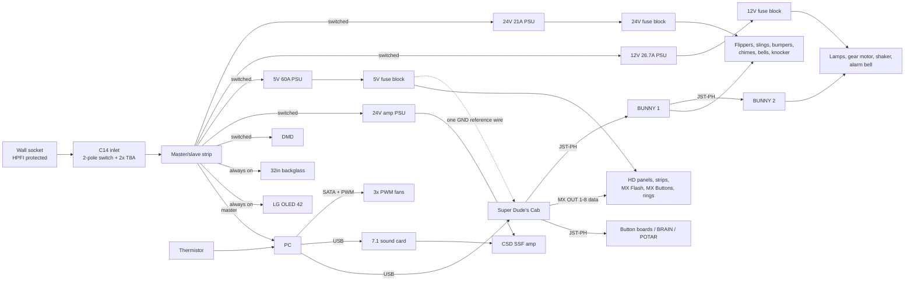

# Virtual Pinball Cabinet – Wiring Plan

Wiring plan for a Tukkari Premium Widebody virtual pinball cabinet built around
Arnoz parts and a **Super Dude's Cab**. It lives in Denmark (230 V / 50 Hz).
The diagrams and per-sheet bills of materials are generated with
[WireViz](https://github.com/wireviz/WireViz). Python, WireViz and Graphviz
are all managed by [mise](https://mise.jdx.dev).

**Published plan:** <https://dipth.github.io/vpin_cabinet/> (all sheets) and
<https://dipth.github.io/vpin_cabinet/bom.html> (shopping list). GitHub Actions
rebuilds and republishes it on every push to `main`; pull requests get the
build as a downloadable artifact instead.

## Quick start

```bash
mise install
```

```bash
mise run build
```

```bash
mise run open
```

| Task | What it does |
| --- | --- |
| `mise run build` | Renders every `harness/[0-9]*.yml` to `build/` (HTML with BOM, SVG, PNG, TSV) and writes `build/index.html` |
| `mise run open` | Builds, then opens the index in your browser |
| `mise run clean` | Deletes `build/` |

Tooling notes:

- Graphviz comes from mise's `conda` backend, which mise still flags as
  experimental. `mise.toml` enables that flag.
- A `postinstall` hook runs `dot -c` to register Graphviz's layout plugins.
  Without it WireViz fails with *"There is no layout engine support for dot"*.
- `harness/_common.yml` holds shared options and YAML anchors (part templates).
  It is prepended to every sheet with `wireviz --prepend`.
- `scripts/routing.py` holds component positions and computes the routed cable
  lengths (`python scripts/routing.py --apply`); see *Cable routing*.
- CI (`.github/workflows/build.yml`) installs the same pinned tools through
  `jdx/mise-action` and runs `mise run build`.

## Sheets

| File | Contents |
| --- | --- |
| `01-mains-power.yml` | Wall → switched/fused C14 inlet → master/slave strip → displays, PC, amp, and the 5 V / 12 V / 24 V Mean Wells, each on its own switched outlet. Feeds the earth bar. |
| `02-inputs.yml` | Super Dude's Cab inputs: 4 Button Boards, all buttons (incl. front Return / Exit), lockbar Fire, under-cab cluster, coin door leaf switches, tilt bob, The BRAIN, POTAR plunger, PC power button, USB. |
| `03-playfield-leds.yml` | One 5 V supply → 12-way fuse block → 6× HD 16x16 backboard panels and the left/right zones (MX Flash + side strip). MX OUT 1-5. LED ground reference. |
| `04-cabinet-backbox-leds.yml` | Same 5 V block: MX Button chain (flippers, magnas, Fire), under-cab U-run, backbox speaker rings and behind-backbox inverted U. MX OUT 6-8. |
| `05-toy-power-bunny.yml` | 12 V and 24 V Mean Wells and fuse blocks, the two BUNNY boards, and the 12 V toys: button lamps, gear motor, shaker motor, alarm bell, Perspex lights on the coin door interlock. |
| `06-audio-video-usb.yml` | GPU → OLED / backglass / DMD, USB 7.1 sound card → CSD SSF amp → 4 exciters, shaker, backbox speakers, subwoofer. |
| `07-cooling.yml` | 3× PWM fans on a SATA-powered hub, speed set by the motherboard from a thermistor inside the cabinet. |
| `08-pe-bonding.yml` | The protective-earth loop: coin door, 4 legs, side rails, lockbar clamps, plunger, backbox hinges and speaker/DMD panel. Verify-or-omit per part. |
| `09-real-mech-coils.yml` | The real mechs on the Tukkari real-mech add-on, all 24 V on BUNNY 1: flippers, slingshots, two rows of three pop bumpers, chimes, shell bells, knocker. Shelf quick-connects. |

Parts that appear on several sheets (Super Dude's Cab, PC, the fuse blocks, BUNNY 1) show
up in several per-sheet BOMs, so don't add those BOMs together blindly.

## Shopping list

`build/bom.html` is the full build BOM: cabinet, pinball hardware, Arnoz
electronics, power and wiring, LEDs, cooling, audio and displays. Only the PC,
tools and parts you already own (HDMI/DisplayPort cables, USB-A → USB-C) are
left out. It is grouped by shop, with links, quantities, and prices in both EUR
and DKK. You can tick rows off as you order, and filter it to one build phase.

- **Source of truth:** `bom/parts.toml` is the one shopping list for the build.
  Change parts or quantities there, not in a separate spreadsheet.
- **Price basis:** shop prices are converted to incl. Danish 25 % moms; quotes
  (the cabinet), DKK prices and estimates are used as written. Estimates and
  not-yet-priced lines are flagged.
- **Priority:** every line is tagged with the earliest build phase that needs
  it (see below).
- **Data:** edit `bom/parts.toml` and rebuild.

## Build phases

You can play after phase 1. Each later phase adds on without rewiring what's
already in, because the trays, lanes and earth loop go in complete from the
start.

| Phase | What it gets you | Sheets |
| --- | --- | --- |
| **1 · Must have** | A playable, safe cabinet on the OLED: flipper and magna buttons, Start, Launch Ball, Exit, the under-cab cluster with the PC power button, cooling, the mains inlet and strip, the full earth loop, all cable trays, and the coin door and playfield glass (they keep the cats out of the cabinet and off the OLED) | 01 (inlet, coupler, strip, earth bar), 02 (most inputs), 07 (fans), 08 |
| **2 · Should have** | The full experience: backglass and DMD, SSF sound, the plunger, tilt, Fire, Return, and the coin switches with The BRAIN | 02 (the rest), 06, 07 (thermistor) |
| **3 · Later** | The light show and the real mechs: the three Mean Well supplies and fuse blocks, both BUNNY boards, HD backboard, MX Flash, side, under-cab and backbox strips, speaker rings, MX Buttons, button lamps, flippers, slings, pop bumpers, chimes, bells, knocker, motors and trim | 01 (PSU cords), 03, 04, 05, 09 |

Things to know when building in phases:
- **Sound before phase 2:** set Windows' audio output to the OLED, so tables play
  through its speakers over HDMI.
- **No backglass or DMD yet:** VPX can show the score display on the playfield
  screen for most tables.
- **Earth loop:** until the shooter is fitted, close its gap in the loop with a
  WAGO 221-413, the same way as for an omitted part.
- **Fans:** until the phase 2 thermistor is in, run the fan curve from the CPU
  temperature.
- **Phase 3 power:** the three Mean Well cords plug into the strip's free
  SWITCHED 1-3 outlets. Nothing in phases 1–2 needs a Mean Well supply: the
  Dude's Cab runs from USB and the SSF amp has its own brick.
- **The real-mech add-on is phase 1**, because its board shelf replaces the
  Tukkari shelf that holds the Dude's Cab. Its mechs can wait for phase 3.
- **Shared parts:** wire, terminals and splices used in several phases are tagged
  with the earliest one, so buying phase by phase never leaves you short.

## System overview



## Power architecture

### Mains (Denmark)

- Plug the cabinet into an **HPFI/RCD-protected** socket (standard in DK).
- Danish type K and Schuko type F plugs are **reversible**, so the inlet switch
  must be **double-pole** and both L and N are treated as live.
- Field-wired 230 V is limited to the inlet → coupler lead and the cut ends of
  three moulded Schuko cords in the Mean Well terminal blocks (under terminal
  covers). There is no distribution box: each Mean Well has its own switched
  outlet. Everything else plugs in with moulded, CE-marked cords.
- The **master/slave strip** powers everything off the PC. Switched: the 5 V,
  12 V and 24 V supplies, the amp brick and the DMD charger. Always-on: the LG
  OLED (cutting its power stops its pixel-refresh cycle; switch it with LGTV
  Companion instead) and the backglass, which sleeps without a signal. Every
  outlet is used; powering the DMD from a PC USB-C port would free one.
- Set the PC BIOS to *Restore on AC power loss = Power On* so the main switch
  starts the whole cabinet. The under-cab button then gives a proper PC shutdown.
- **PE bonding (sheet 08):** all touchable metal is bonded in **one closed
  loop** of 2.5 mm² green/yellow wire that leaves the earth bar, runs around
  the cabinet and through the backbox, and returns to the bar. A loop rather
  than a chain means one broken joint still leaves every part earthed from the
  other direction, which a plain daisy chain cannot do. Order: bar → rear-left
  leg → left rail → left lockbar clamp → front-left leg → coin door →
  front-right leg → plunger → right lockbar clamp → right rail → rear-right leg
  → right hinge → speaker/DMD panel → left hinge → bar. About 13 m of wire (routed) and
  ~28 ring terminals, two per part under one screw with a serrated washer.
  Scrape powder coat back to bare metal under each terminal.
- **The lockbar has no bond wire.** Both of its clamps are in the loop, and the
  bar earths through metal-to-metal contact when it drops in, so there is
  nothing to unplug when you lift it. This must be **confirmed by measurement**
  (see below), since powder coat on the clamp jaws can spoil the contact.

### Why the loop exists, and verify-or-omit

No 230 V wiring runs near any of these parts: mains stays in enclosed,
plug-connected assemblies at the rear. So none of them is an *exposed
conductive part* that the rules require to be earthed. The loop is defence in
depth against a conductor working loose in a cabinet that vibrates for years,
plus a static path that avoids the electronics.

That makes it a **verify-or-omit** job rather than a must-bond-everything one.
Bond a part, then measure plug earth pin → part. At 0.3 Ω or less it stays in;
if it cannot be made good, leave it out rather than fake it, because a bond of
tens of ohms cannot clear a fault but still looks like protection on the
drawing. **If you omit a part, join its two loop wires to each other** (WAGO 221
or a ferruled butt splice) so the ring stays closed.

| Part | Expect | Why |
| --- | --- | --- |
| Coin door frame, 4 leg brackets, hinges, plunger housing, speaker/DMD panel | **Priority bond** | Their hardware (studs, bracket nuts, fixings) is usually bare zinc |
| Side rails, lockbar (via clamps) | **Static only** — bond if it measures | Powder coated, and neither can become live |

Powder coat is not insulation: it chips, and edges, holes and fixings are often
bare. Equally, don't assume a coated part is isolated. To get a good joint
without scraping a show surface, bond to bare hardware rather than the visible
face and use **paint-piercing serrated (star) washers**, which bite through
coating. Black-oxide or black-zinc leg bolts conduct; powder-coated ones do not,
so measure leg → bracket before relying on the bolts.
- Mount PCBs that touch metal (The BRAIN in the coin door, the POTAR on the
  shooter) on nylon standoffs, so logic ground never touches earthed metal.
- If you are not comfortable with 230 V work, have an *autoriseret
  elinstallatør* build or inspect the red boxes on sheet 01.

Estimated mains load: ~3-4 A idling, up to ~6 A with the LEDs bright and the
audio loud. The inlet fuse is a T8A slow-blow (the inlet itself is rated 10 A).

The RSP supplies have active power factor correction (PF > 0.95), so their AC
current tracks watts closely: about 1.5-2 A at 230 V for an RSP-320 and 2.5 A
for the RSP-500 at full rated load. All three flat out is ~6 A, and in practice
the coils fire in short pulses and the LEDs run capped, so the T8A fuses keep
comfortable margin. Inrush is 40-60 A per PSU for a few milliseconds, which the
slow-blow fuses shrug off. If an inlet fuse ever blows in normal use, check the
LED brightness caps and the coil settings before fitting a larger fuse.

### DC supplies and fuses

| Rail | PSU | Fuse | Load | Worst case |
| --- | --- | --- | --- | --- |
| 5 V | RSP-320-5 (60 A) | F1-F6 10 A | HD panels 1-6 (one fuse each) | 55.5 A at full white. Cap brightness ~40% |
| | | F7 15 A | Left zone: MX Flash L + side strip L (~1.3 m, fed at both ends) | 11.4 A |
| | | F8 15 A | Right zone: MX Flash R + side strip R (~1.3 m, fed at both ends) | 11.4 A |
| | | F9 2 A | MX Button chain (5 boards) | 1.2 A |
| | | F10 15 A | Under-cab U-run (~3.0 m, ~180 LEDs) | 10.8 A |
| | | F11 7.5 A | Backbox speaker rings | 4.8 A |
| | | F12 10 A | Behind-backbox inverted U (~2.0 m, ~120 LEDs) | 7.2 A |
| 12 V | RSP-320-12 (26.7 A) | F1 / F2 2 A | BUNNY 1 / BUNNY 2 logic | < 0.5 A each |
| | | F3 2 A | Start, Launch Ball, Return, Exit lamps | 0.2 A |
| | | F4 7.5 A | Gear motor | starts ~5 A |
| | | F5 10 A | Shaker motor, via a ~7 V step-down converter | starts ~6 A |
| | | F6 7.5 A | Backbox: alarm bell | ~2 A |
| | | F7 2 A | Perspex lights (coin door interlock) | < 1 A |
| | | F8-F12 | spare | |
| 24 V | RSP-500-24 (21 A) | F1 10 A | Both flippers | ~6 A pulse each, then ~0.6 A PWM hold |
| | | F2 10 A | Both slingshots | ~6 A pulses |
| | | F3 / F4 10 A | Front / rear pop-bumper row | ~6 A pulses |
| | | F5 10 A | Chimes + shell bells | ~5 A pulses |
| | | F6 7.5 A | Knocker (backbox) | ~5 A pulse |
| PC 12 V | PC PSU (SATA) | PC PSU | 3× PWM fans via hub | 0.5 A |
| 24 V audio | CSD amp brick (12 A) | internal | SSF amplifier | |

Every toy and coil is also fused on its own BUNNY output (5×20 mm slow-blow:
2.5 A for coils, 4 A for the knocker, 5 A for the motors, 1-2 A for lamps and
the bell). The blade fuse at the block protects the wire; the BUNNY fuse protects
the toy and the MOSFET. Each BUNNY carries up to 40 A in total.

One RSP-320-5 now feeds **every** addressable LED, as in James' build. That only
works with brightness caps: set them in the Dude's Cab configurator so everything
lit at once stays under ~50 A. If all the LEDs blink off together (the PSU
hiccuping), the caps are too high.

**Fuses protect the wire; caps manage the load.** Every fuse is sized to its
wire and sits above its group's full-white draw, so a configurator reset or a
firmware update that loses the caps never blows a fuse (James' review point).

The 60 / 26.7 / 21 A ratings are DC output currents and appear only between the
PSU terminals and the blade fuse blocks, where each pole is carried by three
parallel 2.5 mm² wires.

### Ground domains – the most important rule

1. **LED / logic ground**: the Super Dude's Cab, the PC (via USB), everything
   the PC powers (fans and thermistor) and the 5 V LED supply.
   **Exactly one** 0.5 mm² wire runs from the 5 V fuse block's negative bus to
   the Dude's Cab `GND (LED PSU)` terminal. LED data wires are signal-only.
   Because the Dude's Cab touches LED ground in only one place, LED current can
   never flow through the board, even if a strip's ground wire comes loose.
2. **Toy ground**: the 12 V and 24 V fuse blocks' negative buses (bonded with
   2.5 mm²), both BUNNY power grounds and every lamp, motor and coil. The
   BUNNY boards opto-isolate this from the Dude's Cab. **Never** connect toy
   ground to LED ground, a Dude's Cab GND terminal or the PC. This is why the
   fans are powered and PWM-controlled by the PC instead of the 12 V toy rail:
   a PWM wire from the motherboard would bridge the two grounds.
3. **Audio**: the CSD amp's own 24 V brick. Its 0 V stays with the amp; don't
   join it to either of the others.

## Controllable button lamps

Start, Launch Ball, Return and Exit each have a 12 V LED lamp on its own
BUNNY 2 output (DIP address 2). Start, Return and Exit are lit 28 mm arcade
buttons with the LED built in, so watch the polarity on those three; only Launch
Ball takes a W5W LED bulb in the button's own holder. The outputs are PWM, so
DOF can switch, blink and fade each lamp on its own. In the DOF Config Tool,
assign those outputs to the Start Button, Launch Button and your Return/Exit
toys. Tables and ROMs that signal "credits available" will then blink Start
after a coin. Your frontend can drive the same outputs from its menus.

## Real mechs

The Tukkari real-mech add-on replaces Tukkari's two standard shelves with four
braces, each with a clear acrylic shield on top:

| Brace | Size (widebody) | Carries |
| --- | --- | --- |
| Board shelf, front | 585 × 150 mm | Super Dude's Cab, BUNNY 1 and BUNNY 2, under a Perspex cover lit by the coin door interlock |
| Flipper shelf, behind it | 585 × 100 mm | Both flippers, both slingshots, the SSF amp and the USB sound card |
| Front bumper row, mid-cabinet | 585 × 100 mm | Three pop bumpers |
| Rear bumper row, near the backbox | 550 × 82 mm | Three pop bumpers |

All coils run on 24 V and are switched by BUNNY 1; the 12 V toys (gear motor,
shaker motor, alarm bell, button lamps) are on BUNNY 2. The chime unit
sits on the right wall, the two shell bells on the rear wall between the fans,
and the knocker on its side in the backbox (it is too shallow for an upright
knocker; the Data East one has a return spring for this).

- **Removable shelves:** every shelf plugs in through a pluggable terminal block
  (the amp's own green connectors for the speakers), so it lifts out without
  unscrewing a wire. James' biggest regret was routing a cable where a shelf
  could no longer be lifted past it, so keep every wire below or behind the
  braces.
- **Coil protection, three layers** (James' approach, tested on his bench):
  1. the Dude's Cab coil settings: pulse coils FallOff Delay 35 ms / FallOff
     Value 0 %; flippers FallOff Delay 35 ms / FallOff Value 10 % (a PWM hold of
     about 0.6 A) and Security Delay ~60 s. Set these before any coil gets power.
  2. a **Littelfuse RUEF160** resettable PTC (1.6 A hold, 3.2 A trip) in the +
     leg of **every** coil. A stuck coil draws ~6.5 A and burns out in about a
     minute; the RUEF160 trips in under 10 s with no false trips in play. A
     2.5/5 A PTC didn't trip within 15 s. Bumpers and slings fire from DOF, so
     after a crash or an abrupt VPX → frontend exit they can stick unnoticed.
  3. the 2.5 A slow-blow fuse on each BUNNY output (4 A for the knocker), for
     short circuits - on its own it didn't blow within 30 s on a stuck coil.
- **Flipper coil lugs (FL-11629):** power winding MIDDLE-RIGHT (~4 Ω), hold
  winding LEFT-MIDDLE (~122 Ω). +24 V (through the PTC) to the right lug, the
  BUNNY output to the middle lug, left lug unused; 1N4007 across middle-right
  with its band on the right lug. Measure with the diodes lifted, and check
  any factory diode faces the same way: a reversed diode shorts the supply the
  first time the coil fires.
- **Diodes:** every coil needs a 1N4007 across it, band to the + lug. Flipper
  and pop-bumper assemblies usually come with one; chimes, bells and the
  knocker often don't.
- **Motors and bells:** an Arnoz La Nettoyeuse at the gear motor, shaker motor
  and alarm bell (12 V only).
- **Shaker:** runs from a step-down converter at ~7 V, so an output stuck at
  100 % can't drive it at a full 12 V; DOF still varies its intensity. Give its
  output a Security Delay as well.
- **Gear motor:** the standard VW gear motor (191955113A family), upper right:
  about 80 % of tables that use the gear toy put it there.
- **Flippers from the buttons:** link Flipper L/R to BUNNY 1 outputs 1/2 in the
  configurator, so the coils fire straight from the buttons with no PC latency.
- **Nudge:** the Dude's Cab now sits on the add-on's board shelf. James' nudges
  barely registered with a soft 8-rubber mount there, so use a stiff mount and
  test before closing up.
- **Wire colours:** buy red for every + feed and black for every return and
  ground, and label both ends (5V / 12V / 24V, BUNNY output number). The
  diagrams colour 24 V orange and 12 V yellow only to tell them apart.

## Software setup notes

Lessons from James' build that are about configuration rather than wiring:
- **Save it:** after any change in the Dude's Cab configurator, **Send Config**
  then **Save to Memory**, or it is lost at the next reboot.
- **LED counts:** a cut strip sometimes needs a slightly higher LED count than
  you physically counted before every LED lights. Too short a count makes the
  last LEDs show the next segment's effect.
- **Strip direction:** the side strips get their data at the back end, and the
  under-cab U-run runs rear → front on the right and front → rear on the left.
  Use **Arrangement** in the Addressable LEDs tab to reverse segments so the
  effects chase the same way. The configurator's Laser test always shows the
  physical wiring direction, so check with real DOF effects.
- **Sustained white test:** the configurator's tests only pulse. For current or
  colour checks, add a permanent `ON White` line to `directoutputconfig30.ini`.
- **Real flipper and bumper sound:** set VPX's Flippers and Contactors to "DOF
  only" so the real coils make the noise. Night Mode then silences them with no
  VPX fallback, so switch those settings back to sound (e.g. a script editing
  `VPinballX.ini`) when Night Mode is on.
- **8- and 10-bumper tables:** in the DOF Config Tool's Combine Toys, give each
  of the six bumpers every DOF toy a table might use for that position (e.g. the
  middle-left coil gets "8 Bumper Left" and "10 Bumper Middle Left").
- **No `cabinet.xml`** when the LEDs run from the Dude's Cab's MX outputs.
- **VPX key mapping** only lists buttons 1–24, so keep the buttons you need in
  VPX within that range.

## Temperature-controlled fans

The fans connect to a SATA-powered PWM hub inside the PC case, which takes
its speed signal from a motherboard fan header. A 10 k NTC thermistor on the
motherboard's `T_SENSOR` header sits at the top rear of the cabinet interior,
and the BIOS (or the Fan Control app) drives the fans from it. Suggested curve:
30% at 30 °C or below, rising to 100% at 45 °C.
**Buy a motherboard with a thermistor header.** If yours has none, use a USB fan
controller with its own sensor inputs (see sheet 07 notes).

## Cable routing

Wire lengths on the sheets are **routed lengths** for floor cable trays (Stageek
open-slot raceway), not straight-line distances. `scripts/routing.py` holds the
component positions and the path of every long run; move a part there and run
`python scripts/routing.py --apply` to rewrite the lengths. Cables are split into
lanes so noisy and sensitive wiring never share a tray.

| Lane | Carries | Route |
|---|---|---|
| **1 · Mains** | inlet, coupler, strip, the three PSU cords, moulded cords | rear floor, along the rear wall under the strip; the PSU cords go straight into the two rear corners |
| **2a · 5 V + LED** | 5 V feeds, LED data with its ground reference | right-wall floor tray, up the rear-right corner to the backboard; crosses to the left along the underside of the rear bumper-row brace |
| **2b · Toy power** | 12 V and 24 V feeds, BUNNY grounds, toy and coil returns | left-wall floor tray; crosses to the right along the underside of the front bumper-row brace; up the rear-left corner to the backbox |
| **3 · Audio, USB, video** | speaker leads, the amp's 24 V, USB, video, fan and thermistor leads, PC power lead | centre floor tray from the PC to the flipper shelf; up the rear-left corner (separate tray) to the backbox |
| **4 · Signals** | button leads, JST ribbons, POTAR | along the front wall; otherwise local to the button boards |

```
                              REAR WALL
    +---------------------------------------------------------+
    | [12V/24V PSUs]   bells  fans  bells  strip   [5V PSU]   |
    | [12V/24V FBs]  L1 L1 L1 L1 L1 L1 L1 L1 L1   [5V FB]     |
    | L2b               [ PC + amp brick ]             L2a    |
    | L2b    === rear bumper row (LED crossing) ===    L2a    |
    | L2b                    L3                        L2a    |
    | L2b    gear     shaker  L3  BST-1     shaker     L2a    |
    | L2b    motor     motor  L3  shaker    chimes     L2a    |
    | L2b    === front bumper row (toy crossing) ===   L2a    |
    | L2b                    L3   sub                  L2a    |
    | L2b  [ flipper shelf: flippers, slings, amp ]    L2a    |
    | L2b  [ board shelf: BUNNY 1, Dude's Cab, BUNNY 2 ]  L2a  |
    | L4 L4 L4 L4 L4 L4 L4  front wall  L4 L4 L4 L4 L4 L4 L4  |
    +---------------------------------------------------------+
   LEFT                        FRONT                       RIGHT
```

Rules for the lanes:
- **230 V never shares a tray** with anything else.
- **LED data rides with its return:** bundle MX OUT 1–5 and 8 (2.6–3.2 m) with
  the LED ground reference as far as the 5 V fuse block, then with their power
  pairs. If a strip flickers, shorten or shield that data run first.
- **Toy power and LED data never share a tray:** 12/24 V on the left, 5 V and
  data on the right, each crossing on its own brace.
- **Twist** every speaker pair and every toy pair.
- **Line-level audio stays on the flipper shelf:** the sound card sits right next
  to the amp, with short 3.5 mm leads.
- **Crossings:** where lanes meet, cross at right angles, never alongside.
- **Keep the shelves free:** route nothing across a brace's lift-out path.
- Use the included screws as well as the adhesive, since the cabinet gets warm.

How lengths are worked out: each run drops from the part to the nearest tray of
its own lane, follows that lane, then climbs to the other end, plus 15 cm of
service slack at each end, rounded up to 0.1 m. Local runs (jumpers, splice
tails, shelf leads) keep the lengths on their sheets.

**Assumed positions** (James' build and the add-on drawing; move a part and its
lengths change):
- **Board shelf, front:** Super Dude's Cab in the middle, BUNNY 1 left, BUNNY 2 right.
- **Flipper shelf:** flippers and slings at the ends, SSF amp and sound card in the middle.
- **Bumper rows:** front row mid-cabinet, rear row near the backbox, both just
  under the playfield.
- **Rear-left corner, low:** 12 V PSU (215 × 115 mm) with the 24 V PSU
  (230 × 127 mm) above it, both ending ~8 cm short of the rear wall so the
  terminal wiring can bend. Their fuse blocks (5026: 164 × 84 mm, 5025:
  124 × 84 mm) sit just in front on the left wall, below the rear bumper row.
- **Rear-right corner, low:** 5 V PSU with its 5026 fuse block above it, below
  the rear bumper row (the brace and the swinging HD-matrix mount take the space
  higher up). Allow ~4 cm beside each long edge of a fuse block for the wires.
  Nothing sticks out more than ~6 cm from a side wall, leaving ~46 cm for the PC.
- **Rear floor:** PC in the middle, amp brick and DMD charger beside it; inlet,
  coupler and earth bar at the right.
- **Rear wall:** the strip low, two exhaust fans high with the shell bells either side.
- **Middle floor:** shaker motor (right), BST-1 bass shaker and the 6.5" sub in
  the centre. Keep the shaker off the floor beneath the Dude's Cab.
- **Right wall, upper right:** gear motor, in front of the 5 V supply.
- **Right wall, middle:** chime unit.
- **Front:** button boards, The BRAIN, tilt bob, shooter, front intake fan.
- **Top of the playfield, rear end:** backboard and flashers.

LED runs:
- **Side strips:** fed at both ends, with a 1.5 mm² pair inside the profile to
  the front pads. Fed from one end, James' 144 LED/m strips dimmed or cut out
  at the far end on full white.
- **Under-cabinet:** one U-run (~3.0 m) down one side, across the front and back
  along the other side. It starts at the rear-right corner, is fed at both rear
  ends from its own 10 A fuse, and has jumpers at the two front corners.
- **Behind the backbox:** one inverted U (~2.0 m) up the right side, across the
  top and down the left side. It is fed at both bottom ends from its own 7.5 A
  fuse, and its data continues from the right speaker ring.
- **Corners:** cut the strip at each corner and bridge it with a short 3-wire
  jumper, because the strip can't bend within its own plane.

Lengths to check that aren't fully covered by the BOM:
- **Video cables you own:** OLED ~1.8 m, backglass ~1.8 m, DMD ~1.7 m (HDMI into
  the 180° mini-HDMI adapter). 2 m cables are tight; 3 m are safe.
- **USB:** the Dude's Cab and the sound card are ~2.0 m and ~1.8 m from the PC.
  The BOM adds two 2 m USB 2.0 extensions (still no hub).
- **DMD USB-C power cable:** ~1.8 m from the charger on the rear floor to the DMD.
- **CSD speaker leads, from the amp:** top-left exciter ~2.2 m, top-right ~2.4 m,
  bottom-left ~1.4 m, bottom-right ~1.6 m, shaker ~1.0 m. Extend short
  pre-cut leads with the spare 2 × 1.5 mm² speaker cable.

## Removable backbox

The backbox lifts off without tools once a handful of plugs on the backbox floor,
by the neck opening, are undone. All splices and backbox-side wiring stay in
the backbox; nothing field-wired is cut or unscrewed.

| Crossing | Disconnect | Sheet |
| --- | --- | --- |
| Backglass mains cord and DisplayPort | Unplug both at the monitor, pull them down the neck | 01, 06 |
| DMD USB-C power and HDMI | Unplug both at the DMD's 180° adapters; its USB-C charger stays in the cabinet | 01, 06 |
| Both backbox speakers | One speakON NL4 (left 1+/1-, right 2+/2-) | 06 |
| Speaker rings (F11) and behind-backbox strip (F12) | Two XT60s, socket on the cabinet side; label them | 04 |
| Knocker (24 V) and alarm bell (12 V) | One 4-pin pluggable terminal block, socket on the cabinet side | 05, 09 |
| MX OUT 8 LED data | JST-SM 3-pin, data on the middle pin, two spare pins | 04 |
| Earth loop | Two WAGO 221-413 splices; the loop becomes two spurs, so the cabinet stays bonded | 08 |

- Make the neck opening big enough for the plugs that come back through it
  (speakON, IEC C13, DisplayPort/HDMI), or leave those cables lying on the
  cabinet while the backbox is off.
- A future topper fits the same pattern: the spare XT60 for its power and a
  spare pin on the data plug. There are no beacons, so the backbox top stays clean.
- Re-test the earth loop after refitting the backbox (sheet 08).

## Safety checklist before first power-up

- [ ] Terminal covers fitted on all three PSUs (TBC-09 on the RSP-320s, a printed one on the RSP-500), FG wired to PE, each cord P-clipped within 5 cm. The RSPs are universal input, so there is no 115/230 V selector to set.
- [ ] Inlet fuses T8A H fitted in both L and N; inlet switch is double-pole.
- [ ] Unplugged, measure plug earth pin → coin door, each leg, both side rails, lockbar, plunger, both hinge leaves and the speaker/DMD panel: aim for ≤ 0.3 Ω each.
- [ ] Lockbar: lift and refit it several times, re-measuring each time. If it is erratic, enlarge the bare contact patch on the clamp jaws — or accept the lockbar as unbonded, which is a legitimate choice.
- [ ] Any part that will not come below 0.3 Ω: leave it out of the loop and join its two loop wires together, so the ring stays closed.
- [ ] Because the bonding is a loop, one bad joint hides itself. Re-test the whole loop after any work that disturbs a bonding screw.
- [ ] All blade fuses **removed**. Power up the PSUs alone and set V.ADJ (5.10-5.20 V / 12.0 V / 24.0 V at the fuse blocks).
- [ ] With power off, check polarity at every LED load and continuity on every JST ribbon.
- [ ] 330 Ω series resistor in each MX data line at the first LED.
- [ ] No wire between toy ground and LED ground. The 12 V and 24 V negatives **are** bonded to each other.
- [ ] Brightness caps set in the Dude's Cab configurator (one 60 A supply feeds every LED). The fuses don't depend on them, but the PSU does.
- [ ] Fit fuses one circuit at a time with the configurator's LED test running.
- [ ] Flyback diode on every coil (band on the + lug); RUEF160 in the + leg of every coil; La Nettoyeuse on the gear motor, shaker motor and alarm bell.
- [ ] Shaker step-down converter set to ~7 V with the motor disconnected.
- [ ] Coil protection set in the configurator (Max ON / Security Delay; flipper FallOff) **before** fitting the 24 V fuses. Fire each coil once from the configurator's test page.
- [ ] Each BUNNY output has its 5×20 mm fuse fitted with the rating on its label.
- [ ] Every shelf lifts out with only its quick-connect unplugged.

## Verify against your actual hardware

The plan follows Arnoz's published documentation, but some details were not
documented and are assumptions. Check these before crimping:

1. **Super Dude's Cab silkscreen**: the pin names come from the Dude's Cab v1
   manual. The Super adds `MX OUT 1-8` and an LED-PSU `GND`; confirm their
   connector type.
2. **BTRA / BTRB ribbon pin order**: parts of the manual's pin tables didn't
   extract cleanly. Buzz each Button Board terminal back to the Dude's Cab
   with a multimeter.
3. **Brain1 / Brain2 JST split**: assumed to follow the BRAIN screw-terminal
   order (CAL BT … ROM EXIT / ROM- … VOL+). The BRAIN plugs straight in, so this
   only matters if you wire in parallel.
4. **MX Button / MX Flash / HD panel connectors**: assumed 3-pin +5V/DATA/GND
   plugs and pads.
5. **BUNNY terminal names and fuse sizes**, and that every output switches
   the low side (Arnoz's manual says so). Also that your button lamp holders
   take 12 V LED lamps.
6. **CSD amp jack labels and 7.1 channel mapping**: follow CSD's install
   guide if it differs.
7. **Motherboard thermistor header** name and location (`T_SENSOR` etc.), and
   the hub's port count.
8. **Which metal parts can actually be bonded.** The lockbar, side rails, legs
   and speaker panel are powder coated, and neither the coin door's nor the leg
   bolts' finish is documented by the supplier. Measure first, then decide
   which parts stay in the loop.
9. **Power-corner fit**: before drilling, tape cardboard templates of the PSUs
   and fuse blocks (sizes under Assumed positions) to the rear walls, swing the
   playfield up and down with the HD-matrix mount fitted, and check nothing
   touches. James found the matrix mount drops close to the rear side walls.
10. **Real-mech add-on dimensions and positions**: the brace sizes come from
   James' widebody build; their exact x-positions, and where the PC and the
   rear PSUs fit around them, are estimates in `scripts/routing.py`. Measure
   once the add-on arrives and re-run it.
11. **Coil diodes**: check every flipper, bumper, chime, bell and knocker coil
   for a fitted diode before wiring it.
12. **Night Mode**: the Dude's Cab accepts one Night Mode input. Either choose
   the under-cab button (SPARE 3) in the configurator, or move its wire in
   parallel with the BRAIN's `NightM` terminal (see sheet 02 notes).

## Future toys

- BUNNY 2 outputs 10-16 are free (7 outputs, up to 8 A each), and the 12 V fuse
  block has F8-F12 spare: room for strobes, a topper blower, coin door lamps or
  a second gear motor.
- BUNNY 1 is fully used by the 24 V coils. More coils need a third BUNNY,
  chained from BUNNY 2's `DATA OUT` (DIP address 3), and a free circuit on a
  24 V block (the 6-way is full: swap it for a 12-way 5026).
- The 5 V block is full. A topper with more addressable LEDs either shares a
  backbox circuit or gets a second 5 V supply.
- **Rail monitoring (James' idea):** a clamp-on DC Hall current sensor around
  each PSU's + feed into an ESP32 (ESPHome → Home Assistant) measures the real
  current per rail - brightness caps, coil inrush (he sees 15-30 A spikes on the
  24 V rail) and flipper hold - instead of estimating it. The clamps are
  isolated, so they don't bridge the ground domains.
